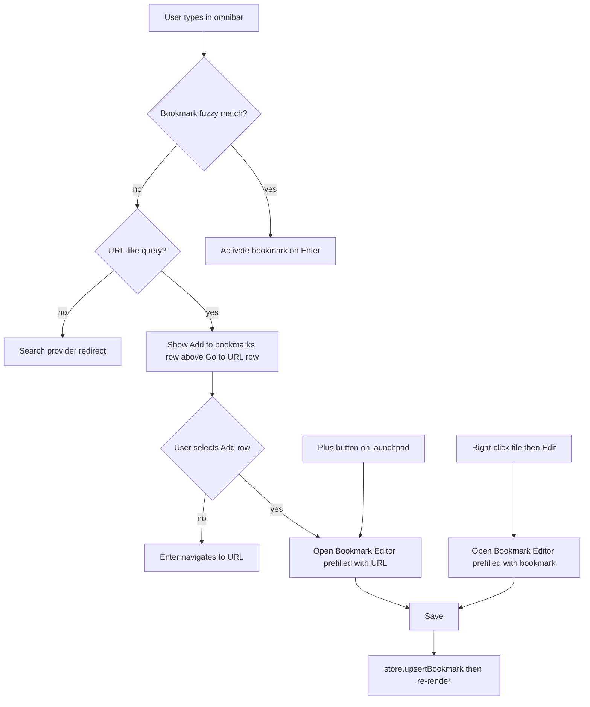

# Plan — Bookmark Add & Edit Flow

**Project:** Hub
**Parent Specs:** [`PRD.md`](../PRD.md), [`SCHEMAS.md`](../SCHEMAS.md), [`AGENTS.md`](../AGENTS.md)
**Status:** Proposed

---

## 1. Problem

The main bookmark screen has no way to create or edit bookmarks. The empty state
already instructs the user to _"Press '+' or use Settings to import your links"_,
but no `+` control exists, and tiles only expose a right-click menu that opens
primary/mirror URLs. The only creation path today is the share-target prompt
([`ShareTargetPrompt`](../src/components/share-target.ts:28)) and the
`?action=new-bookmark` launch intent, both of which capture only `title` + `url`.

## 2. Goal

Deliver a first-class, keyboard-friendly add/edit flow:

1. Typing a URL in the omnibar surfaces an **Add to bookmarks** action row above
   the direct-navigate row. `Enter` still navigates by default; the add row is
   selectable via `ArrowUp`/click.
2. Selecting **Add to bookmarks** opens a full **Bookmark Editor** modal
   prefilled with the URL.
3. A `+` control on the launchpad opens the same editor in create mode.
4. Tiles expose **Edit** and **Delete** in the existing context menu.
5. The editor covers: title, URL, alternate URLs, category (with inline
   "new category"), icon, and hotkey.

## 3. Interaction Flow

## 4. Work Breakdown

### 4.1 New component — `src/components/bookmark-editor.ts`

A modal class mirroring the established [`NoteEditor`](../src/components/note-editor.ts:31)
pattern (overlay + dialog, `is-open` class, Escape/backdrop dismiss, XSS-safe
`el()` construction).

- **Fields:**
  - `title` — text input (defaults to hostname/URL when blank).
  - `url` — text input, required, normalised via `normalizeUrl`.
  - `alternate_urls` — textarea, one URL per line, trimmed and filtered.
  - `category` — `<select>` of active categories plus a `New category…` option
    that reveals an inline text input.
  - `icon` — optional text input (URL); blank falls back to favicon service.
  - `hotkey` — `<select>` of `None` + `1`–`9`.
- **Callbacks:**
  - `onSave(bookmark: BookmarkItem): Promise<void> | void`
  - `onDelete(id: string): Promise<void> | void`
  - `onCreateCategory(name: string): Promise<CategoryItem>`
  - `isHotkeyTaken(hotkey: string, excludeId?: string): boolean`
- **API:** `open(bookmark?: BookmarkItem, prefill?: { url?: string })` — edit
  mode when a bookmark is supplied, otherwise create mode.
- **Validation:** URL required; hotkey conflict blocks save with an inline
  status message; title falls back to the URL hostname.
- **Pure helpers exported for tests:** `parseAlternateUrls(text)`,
  `buildBookmarkFromForm(...)` (or equivalent) so logic is unit-testable
  without a DOM.

### 4.2 Omnibar — `src/components/omnibar.ts`

- Introduce an `OmnibarAction` union:
  `{ kind: 'bookmark' | 'add' | 'navigate' | 'search', ... }`.
- Add a pure, exported `buildOmnibarActions(query, bookmarks, providers, preferredId)`
  that returns the ordered action list. For a URL-like query with no bookmark
  match it returns `[add, navigate]`; otherwise it preserves the current
  bookmark → URL → search precedence.
- Render the **Add to bookmarks** row above the navigate row with a distinct
  icon/label. Default `activeIndex` remains the navigate/search row so `Enter`
  still navigates by default; the add row is reachable via `ArrowUp`/click.
- Add callback `onAddBookmark(url: string)` to `OmnibarCallbacks`.
- Keep existing `resolveQuery`/`filterBookmarks` exports and tests intact.

### 4.3 Bookmarks view — `src/components/bookmarks.ts`

- Extend the context menu with **Edit** and **Delete** entries (Delete uses a
  confirm step before `softDeleteBookmark`).
- Add `onEdit(bookmark)` and `onDelete(bookmark)` to `BookmarksCallbacks`.
- Keep the existing primary/mirror open entries.

### 4.4 Launchpad `+` control — `src/main.ts`

- Add an **Add bookmark** button (the `+` referenced by the empty state) in the
  launchpad center, wired to open the editor in create mode.
- Route the `?action=new-bookmark` launch intent to the new editor.

### 4.5 Share target — `src/components/share-target.ts` + `src/main.ts`

- Route bookmark-kind share drafts (from [`draftFromShare()`](../src/core/pwa.ts:95))
  to the new **Bookmark Editor**, prefilled with the shared title and URL,
  replacing the share prompt's bookmark path.
- Simplify `ShareTargetPrompt` to a **note-only** prompt: remove its
  `onCreateBookmark` callback and "Save bookmark" button so there is a single
  bookmark-creation path.
- Keep the note-kind share flow on `ShareTargetPrompt` unchanged.

### 4.6 Bootstrap wiring — `src/main.ts`

- Instantiate `BookmarkEditor` and append to `document.body`.
- Add `openBookmarkEditor(bookmark?)` helper.
- Wire `omnibar.onAddBookmark`, `bookmarksView.onEdit`, `bookmarksView.onDelete`,
  the `+` button, and the bookmark-kind share intent.
- Implement `onCreateCategory` (order = max + 1, stamped with `activeProfileId`).
- Add the editor to `closeTopLayer()` so gamepad `back`/Escape close it.
- Reuse the existing `bookmarks`/`categories` subscriptions for re-render.

### 4.7 Styles — `src/styles/components.css`

- Editor modal field styles (reuse `.field`, `.modal`, `.button` tokens).
- Alternate-URLs textarea, category row + inline new-category input, hotkey
  select, and the omnibar **Add to bookmarks** action row (distinct accent).

### 4.8 Tests

- `src/components/__tests__/bookmark-editor.test.ts` — alternate-URL parsing,
  URL normalisation, title fallback, hotkey-conflict validation, and the
  create-vs-edit payload shape.
- Extend `src/components/__tests__/omnibar.test.ts` — `buildOmnibarActions`
  returns the add row for URL-like queries, preserves bookmark precedence, and
  keeps the navigate row as the default action.

## 5. Constraints & Guardrails

- Vanilla TS + `el()` only; no `innerHTML`, no new runtime dependencies.
- All new entities stamped with `profile_id` and `created_at`/`updated_at`.
- Deletes are soft tombstones (`is_deleted: true`) so sync propagates them.
- No new tabs: navigation stays `window.location.href`.
- `npm run typecheck`, `npm run lint`, and `npm run test` must pass.

## 6. Definition of Done

- [ ] `+` control and omnibar **Add to bookmarks** row both open the editor.
- [ ] Bookmark-kind share intents and `?action=new-bookmark` open the editor;
      the share prompt is note-only.
- [ ] Tile context menu offers Edit and Delete (soft delete).
- [ ] Editor persists all fields and validates URL + hotkey conflicts.
- [ ] Inline "new category" creates and selects a category.
- [ ] `Enter` on a URL still navigates by default.
- [ ] New/updated unit tests pass; typecheck and lint are clean.
