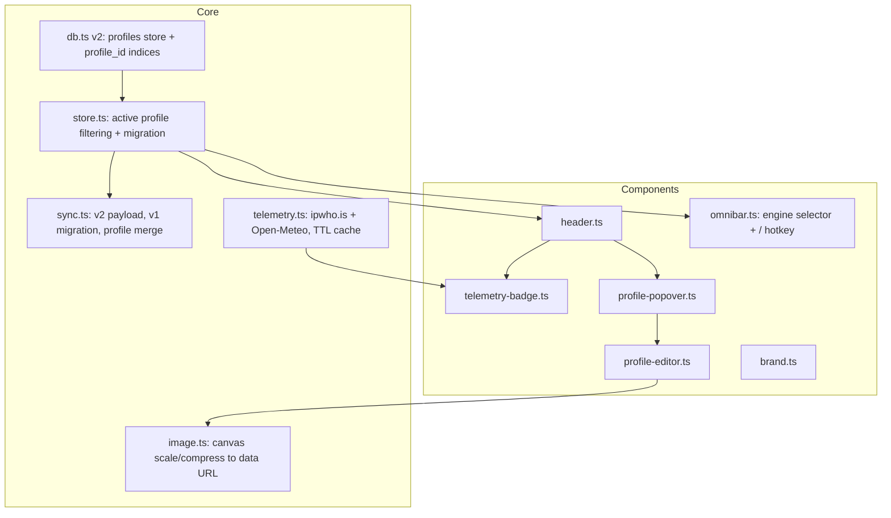

# Hub Main Interface Refactor & Multi-Profile Architecture — Plan

**Status:** Complete — **partially superseded.** The environment-telemetry feature in this plan (IP/location via `ipwho.is`, weather via Open-Meteo, the `telemetry.ts` / `telemetry-badge.ts` files and the header's left cluster) is **removed from the product** by the owner's decision (PRD v1.1.0 §2.2) and scheduled in [`production-readiness.md`](production-readiness.md) Phase 9. The target header is specified in [`DESIGN.md`](../DESIGN.md) §6.1. Profile, brand and search-pill requirements remain in force.

## Goal

Refactor Hub's landing experience into a clean, full-width start-page layout
(edge-to-edge system header, centered brand, enlarged search pill) and add
isolated multi-profile support with non-destructive migration of existing data.

## Guardrails

- Zero-framework, local-first stack (Vanilla TS, native CSS tokens, IndexedDB,
  PWA service worker). No new runtime dependencies.
- Backward-compatible persistence: never drop existing bookmarks/tasks/notes.
- Non-blocking network: telemetry (IP/location/weather) is async, cached, and
  fails silently to an offline badge.
- Modular DOM: new UI as separate components talking through the store.

## Confirmed decisions

- Telemetry: **ipwho.is** (IP + city/country + coordinates) and **Open-Meteo**
  (current weather). 30-minute local TTL cache.
- Sync payload: bump to **version 2** with automatic **v1 migration**.
- Sync file: **one shared file** for all profiles (per-profile `sync_path` is
  stored as a preference but the shared file is used).

## Schema changes (authorized)

```ts
export interface ProfileItem extends SyncableEntity {
  name: string;
  avatar?: string; // data URL or remote URL
  hub_title?: string; // custom space title
  logo?: string; // data URL (compressed)
  default_search_provider_id?: string;
  theme?: 'auto' | 'light' | 'dark';
  sync_path?: string; // preference (shared file used)
}
```

- Add `profile_id: string` to `BookmarkItem`, `CategoryItem`, `TaskItem`,
  `NoteItem`.
- `AppConfig.active_profile_id?: string`.
- `HubStoragePayload` -> `version: 2` and `profiles: ProfileItem[]`.
- `SYNCABLE_COLLECTIONS` gains `profiles`.

## Architecture



## Workstreams

### 1. Profiles, partitioning & migration

- `db.ts`: `DB_VERSION = 2`; add `profiles` store (+ `idx_updated_at`) and
  `idx_profile_id` on bookmarks/categories/tasks/notes (additive upgrade).
- `store.ts`: hold `profiles` + `activeProfileId`; filter all active getters by
  the active profile; add `upsertProfile`/`softDeleteProfile`/`setActiveProfile`
  and a `profiles` event.
- `migrateProfiles()`: if no profiles exist, create a default profile, assign
  every entity with a missing/empty `profile_id` to it, persist, and set active.

### 2. Sync v2

- `mergePayloads`/`cullPayloadTombstones` include `profiles`; emit `version: 2`.
- `parsePayload` accepts v1 (migrate: wrap entities into a default profile) and
  v2; `isHubStoragePayload` updated. Merge stays non-destructive (LWW).

### 3. Edge-to-edge system header

- `header.ts`: full-width header with a left telemetry cluster and a right
  profile cluster (avatar + name, drawer toggles, sync status).
- `telemetry-badge.ts`: IP, location label, weather + temperature; offline/error
  fallback badge.
- `telemetry.ts`: async fetch + 30-min TTL cache; pure helpers for TTL and
  weather-code mapping.
- `profile-popover.ts`: quick-switch, add profile, profile config, global
  settings (opens the existing `SettingsModal`).

### 4. Centered brand & enlarged search pill

- `brand.ts`: render the active profile's logo, else its `hub_title`, else a
  sensible fallback.
- `omnibar.ts`: enlarged pill with an inline search-engine selector (left side);
  switching updates the profile's default engine; submission respects it.
  Preserve fuzzy bookmark matching, direct URL navigation, and search fallback.
- Global `/` hotkey focuses the pill and selects existing text; ignored while
  typing in an input/textarea/select or when a modal is open.

### 5. Profile editor & media

- `profile-editor.ts`: name, avatar, custom logo, default engine, theme.
- `image.ts`: canvas-based scale/compress (max 256px, WebP with JPEG fallback)
  to keep IndexedDB and sync payloads lightweight; pure `computeScaledDimensions`.

### 6. Tests & docs

- Unit tests: telemetry cache/mapping, image dimension math, store profile
  filtering + migration, sync v1->v2 migration + profile merge, schema defaults.
- Update `README.md`, `SCHEMAS.md`, `DESIGN.md`.

## Logical commits

1. `feat(profiles): profile schema, entity partitioning and v1->v2 migration`
2. `feat(sync): v2 payload with profiles and backward-compatible parsing`
3. `feat(header): edge-to-edge system header with telemetry and profile controls`
4. `feat(search): centered brand, enlarged search pill with engine selector and / hotkey`
5. `feat(settings): profile editor with avatar/logo upload and image compression`
6. `test(docs): coverage and documentation for profiles and the new interface`

## Verification

- `npm run typecheck`, `npm run test`, `npm run build`, `npm run lint`.
- Pre-commit hook (typecheck + tests) on each commit; push to `origin main`.
- Manual: existing data migrates without loss; `/` focuses the pill; switching
  profiles swaps bookmarks/tasks/notes; offline shows a fallback telemetry badge
  with no console errors.
