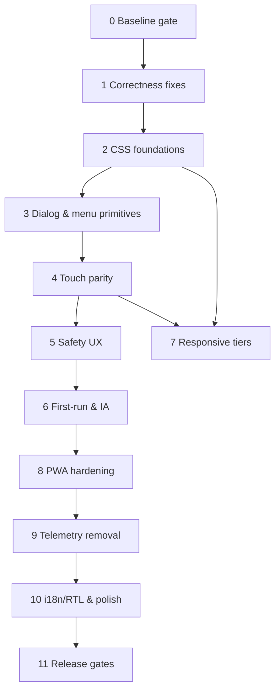

# Hub — Production-Readiness: Gap Analysis & Phased Roadmap

**Status:** Complete — Phases 0–11 delivered (baseline, correctness, CSS foundations, dialog/menu primitives, touch parity, safety & feedback UX, first-run & information architecture, responsive tiers, PWA hardening, telemetry removal, i18n/RTL & polish, release gates). See §6 for the Phase 11 verification record and the device-matrix status.
**Parent specs:** [`PRD.md`](../PRD.md) (v1.1.0), [`DESIGN.md`](../DESIGN.md) (v2.0), [`docs/accessibility.md`](../docs/accessibility.md), [`SCHEMAS.md`](../SCHEMAS.md), [`AGENTS.md`](../AGENTS.md)
**Supersedes:** the "Remaining Work" items in [`remaining-work-phases.md`](remaining-work-phases.md) that overlap with this plan.

---

## 1. Why this plan exists

A source-level audit (CSS and layout, components and accessibility, PWA) found that Hub's architecture is sound but its product is **desktop-and-mouse-first with a mobile skin**. The owner's primary use case is **quick access to key information on the go**, so mobile is the primary experience, not an adaptation. This plan records the audit (current → ideal → gap) and orders the work to close it.

**Method caveat:** findings come from reading source. Contrast ratios were computed from hex values. Browser- and device-level claims (iOS long-press behaviour, forced-colors rendering, Lighthouse scores) must be re-verified on real devices as part of Phase 11.

**Owner decisions (binding):**

- Mobile-first. Key information must be reachable in seconds, one-handed, offline.
- **Remove** the IP / location / weather telemetry (`ipwho.is`, Open-Meteo) entirely.
- Build-time **dev** dependencies are allowed (e.g. `vite-plugin-pwa`). Runtime dependencies remain forbidden.
- The new local-only `AppConfig` fields listed in `SCHEMAS.md` §3.3, §3.5 and §3.6 are approved.
- **Profile deletion:** cascading soft delete of the profile and its items with a shared timestamp, Undo toast, and 30-day recovery via Settings → Data → Recently deleted (`SCHEMAS.md` §5.4, `DESIGN.md` §9.1).
- **GitHub token:** encrypted at rest with a non-extractable WebCrypto key (not tied to app lock) plus scoped-token guidance (`SCHEMAS.md` §3.5). _Storage shape approved by the owner (`SCHEMAS.md` §3.5)._
- **Hotkeys:** `g` then `1…9` is the primary pinned-bookmark shortcut; `Alt+1…9` stays as an optional extra (`DESIGN.md` §4.5). _The "shortcuts on/off" setting uses the approved `single_key_shortcuts_enabled` field (`SCHEMAS.md` §3.6); it ships together with the single-key shortcuts (WCAG 2.1.4)._
- **Window Controls Overlay:** implement it properly (`DESIGN.md` §3.1); it is not removed from the manifest.
- Document versions: PRD 1.1.0, DESIGN 2.0.

---

## 2. Gap analysis

Severity: **C** = critical (blocks users or violates a standard), **H** = high, **M** = medium/polish. IDs (`G-xx`) are referenced by the phases in §3 and by the traceability table in §4.

### 2.1 Visual design and tokens

| ID   | Sev | Current                                                                                                                                                                                                   | Ideal / required                                                                                                   |
| ---- | --- | --------------------------------------------------------------------------------------------------------------------------------------------------------------------------------------------------------- | ------------------------------------------------------------------------------------------------------------------ |
| G-01 | C   | `--text-faint` is 2.4–2.8:1 (light) and 2.9–3.5:1 (dark), yet carries real content (placeholders, URLs, done tasks, empty states, hints).                                                                 | All text ≥ 4.5:1. See [`DESIGN.md`](../DESIGN.md) §2.3 for the corrected palette.                                  |
| G-02 | C   | White text on terracotta (3.6:1), on sage (3.6:1) and, in dark mode, on the lightened accent (2.95:1). Terracotta and amber as small text fail on cards.                                                  | Primary buttons and checked fills ≥ 4.5:1; use a darker light-mode fill and dark text on the light dark-mode fill. |
| G-03 | C   | Control borders (`--border-light`, `--border-active`) are 1.2–1.5:1; inputs are nearly invisible.                                                                                                         | Input and control boundaries ≥ 3:1 via a dedicated `--border-control` token.                                       |
| G-04 | C   | Focus ring is `outline: none` + 35%-alpha box-shadow (~1.5:1) and vanishes in forced-colors mode.                                                                                                         | Solid 2 px outline ≥ 3:1 with offset; transparent-outline fallback.                                                |
| G-05 | H   | Dark values triplicated (media query + two `[data-theme]` blocks); legacy and canonical token names coexist; unused tokens; no `color-scheme`, so native controls and scrollbars ignore the in-app theme. | One value per token, one naming system, `color-scheme` set from the effective theme.                               |
| G-06 | H   | 12–14 px text everywhere, hard-coded 11 px hints, sub-16 px inputs (iOS zooms on focus), weak heading hierarchy.                                                                                          | Type scale used consistently; inputs ≥ 16 px on coarse pointers; clear hierarchy.                                  |
| G-07 | M   | Control heights vary (22/28/34/36/52 px); three text-field styles; no `:disabled`, `:active`, `:invalid`, loading or skeleton states; toast variants differ by a 1 px border.                             | One control-size scale, full state matrix, icon + colour per toast variant.                                        |
| G-08 | C   | Toast `z-index` (300) is below modals (400) and the lock overlay, so toasts raised from a modal are hidden.                                                                                               | Complete named z-index scale with toasts above modals.                                                             |

### 2.2 Responsive and multi-device

| ID   | Sev | Current                                                                                                                          | Ideal / required                                           |
| ---- | --- | -------------------------------------------------------------------------------------------------------------------------------- | ---------------------------------------------------------- |
| G-09 | H   | One mobile switch (≤ 768 px) and pinning at ≥ 1024 px; tablets (769–1023 px) get an overlay drawer with no scrim.                | Six defined tiers (see DESIGN.md §3) with per-tier layout. |
| G-10 | M   | Centre column fixed at 640 px; ~1000 px dead space each side on a 2560 px display; tile grid capped at ~4 columns.               | Fluid/container-query grid that uses available width.      |
| G-11 | H   | Phone landscape gets the portrait layout; fixed tab bar + sticky omnibar consume a ~390 px-tall viewport.                        | Compact landscape chrome.                                  |
| G-12 | M   | No foldable/dual-screen handling.                                                                                                | Viewport-segment and container-query awareness.            |
| G-13 | C   | `100vh` everywhere, so the bottom is cut off behind mobile URL bars.                                                             | `100dvh` with `vh` fallback.                               |
| G-14 | C   | No `viewport-fit=cover`, no `env(safe-area-inset-*)`; tab bar collides with the iOS home indicator; toasts sit over the tab bar. | Notch, home-indicator and landscape insets handled.        |
| G-15 | H   | Text-only mobile tab bar with no icons, counts or distinct active state; no tab transition.                                      | Icon + label tabs with counts and a clear active state.    |
| G-16 | H   | No `visualViewport` handling; the keyboard covers modal actions and creator rows.                                                | Modals/sheets reflow above the keyboard.                   |
| G-17 | M   | No `overscroll-behavior`, `touch-action`, tap-highlight control, or `:active` feedback.                                          | Contained scroll, no 300 ms delay, pressed states.         |
| G-18 | M   | Desktop-style centred modals on phones.                                                                                          | Bottom sheets on phones.                                   |
| G-19 | M   | Context menu positioned at raw click coordinates with no viewport clamping.                                                      | Clamped to the viewport.                                   |

### 2.3 Touch and input modality

| ID   | Sev | Current                                                                                                                                                                 | Ideal / required                                                                |
| ---- | --- | ----------------------------------------------------------------------------------------------------------------------------------------------------------------------- | ------------------------------------------------------------------------------- |
| G-20 | C   | Zero `pointer*`/`touch*` handlers; everything is `click`, `mousedown`, `mouseenter`, `contextmenu`, HTML5 drag.                                                         | Pointer Events throughout.                                                      |
| G-21 | C   | Most targets < 44 px (check 22, drag 16×22, task menu 28, note actions 28, swatches 22, chips ~22, buttons ~34, icon buttons 36).                                       | ≥ 44 px hit area on `(pointer: coarse)`; 24 px absolute floor.                  |
| G-22 | C   | Task menu, drag handle and note toolbar (Pin/Colour/Copy/Delete) are `opacity: 0` until hover; invisible on touch; no `(hover: none)` fallback.                         | Visible on touch or reachable through an explicit "more" affordance.            |
| G-23 | C   | Bookmark edit/delete/mirror override only via right-click; iOS Safari does not fire `contextmenu` on long-press; no keyboard route.                                     | Visible "more" button + Pointer-Events long-press + keyboard menu key.          |
| G-24 | H   | Task reorder/nesting uses HTML5 DnD (unreliable on touch), invisible handle, hidden 25 %/50 % drop zones.                                                               | Pointer-based DnD plus explicit Move up / Move down / Indent / Outdent actions. |
| G-25 | M   | No swipe, pull-to-sync or haptics.                                                                                                                                      | Optional swipe actions and light haptics (progressive enhancement).             |
| G-26 | M   | Hotkey hints (`/`, `Alt+n`, tile badges) show on touch devices.                                                                                                         | Hidden on `(hover: none)`/coarse pointers.                                      |
| G-27 | H   | No `inputmode`/`enterkeyhint`/`type=url`/`autocapitalize`/`autocorrect` on URL, owner, repo, branch fields; omnibar auto-focuses on boot and raises the phone keyboard. | Correct keyboard per field (DESIGN.md §4.3); no auto-focus on coarse pointers.  |

### 2.4 Accessibility (WCAG 2.2 AA)

| ID   | Sev | Current                                                                                                                                                                                                                                                                      | Ideal / required                                                                                                    |
| ---- | --- | ---------------------------------------------------------------------------------------------------------------------------------------------------------------------------------------------------------------------------------------------------------------------------- | ------------------------------------------------------------------------------------------------------------------- |
| G-28 | C   | Modals declare `aria-modal` but have no focus trap, no inert background, no focus restore; Escape missing on the profile editor, share prompt and confirm dialogs; confirm dialogs have no name, message or initial focus.                                                   | One shared dialog helper (trap, inert, restore, Escape, `aria-labelledby`).                                         |
| G-29 | C   | `/` and `Alt+n` still work behind the lock overlay.                                                                                                                                                                                                                          | Lock blocks all input and background focus.                                                                         |
| G-30 | H   | Omnibar combobox: no `aria-activedescendant`, no option ids, no result announcements, unlabelled listbox, no blur close, Escape clears and blurs in one step.                                                                                                                | Full ARIA APG combobox with two-stage Escape.                                                                       |
| G-31 | H   | Missing/incorrect ARIA state: tabs lack `aria-current`; drawer toggles, profile button, task menu lack `aria-expanded`; pin has no state; `role="menu"` without arrow keys; swatches not roving; drag handle role-less; sync dot bare span; completed checkboxes unlabelled. | Correct states and keyboard patterns (accessibility.md §4).                                                         |
| G-32 | H   | Note cards are `role="button"` wrapping real buttons; no list semantics; `<header>` inside `<main>`; no skip link; `<h1>` disappears when a logo is set.                                                                                                                     | Valid landmarks and lists.                                                                                          |
| G-33 | H   | Tile edit/delete and task reorder are mouse-only; every tile is a Tab stop; `Alt+digit` collides with browser/OS shortcuts; drawers have no Esc.                                                                                                                             | Keyboard parity; `g`+digit chord as the primary shortcut with Alt+digit optional; roving tabindex in the tile grid. |
| G-34 | M   | Colour-only meaning (sync dot, swatches, task state under forced-colors).                                                                                                                                                                                                    | Redundant text/shape cue.                                                                                           |
| G-35 | H   | `prefers-contrast` and `forced-colors` unhandled (reduced-motion is handled).                                                                                                                                                                                                | Both handled.                                                                                                       |
| G-36 | H   | No `required`/`aria-invalid`/`aria-describedby`; error line at the bottom of long modals; no `<form>` (no Enter-to-submit); silent no-ops on empty submit.                                                                                                                   | Inline validation, focus first error, forms.                                                                        |
| G-37 | H   | Toasts fixed 4 s, no pause/dismiss/action; errors announced politely; duplicates stack.                                                                                                                                                                                      | Persistent `role="alert"` errors, pausable, dismissible, deduplicated.                                              |
| G-38 | M   | All strings hard-coded; physical CSS properties; no `dir`; emoji-unsafe avatar initials.                                                                                                                                                                                     | String catalogue, logical properties, locale-aware formats.                                                         |

### 2.5 UX, psychology and design thinking

| ID   | Sev | Current                                                                                                                                                                                                                          | Ideal / required                                                                                                                                    |
| ---- | --- | -------------------------------------------------------------------------------------------------------------------------------------------------------------------------------------------------------------------------------- | --------------------------------------------------------------------------------------------------------------------------------------------------- |
| G-39 | H   | First run: empty page and a passive sentence referencing a non-existent `+` key; no CTA, no sample data; features undiscoverable; first bookmark silently creates a category named "Shared"; no category management.             | Guided empty state with primary actions, optional sample set, category management.                                                                  |
| G-40 | C   | No delete confirmation or undo for tasks, notes, profiles; import overwrites with no confirmation; profile delete sits beside Save, same styling, and allows deleting the last profile; closing editors discards edits silently. | Undo toasts, danger styling, unsaved-changes guard, import preview, last-profile guard, cascading profile soft-delete with 30-day Recently deleted. |
| G-41 | H   | Blank screen until IndexedDB opens; no bootstrap error boundary; settings async actions lack `catch` (stuck on "Testing…"); bookmark open probes the primary URL with no feedback.                                               | Skeleton, error boundary, busy/optimistic states.                                                                                                   |
| G-42 | H   | Settings is one long scroll of four concerns with expert fields first-class; Save scope unclear; Recent tiles duplicate category tiles (double Tab stops); recurrence chip hides its options.                                    | Progressive disclosure, Advanced section, grouped settings.                                                                                         |
| G-43 | C   | Boot-time calls to `ipwho.is` and Open-Meteo contradict the air-gapped promise, expose the user's IP on screen, and take the premium header corner.                                                                              | **Removed** (owner decision).                                                                                                                       |
| G-44 | M   | Reminders are a 4 s toast; no global offline or pending-sync indicator.                                                                                                                                                          | Persistent accessible status chip.                                                                                                                  |

### 2.6 PWA and native-like capability

| ID   | Sev | Current                                                                                                                                                                                                                                 | Ideal / required                                                                                                                                        |
| ---- | --- | --------------------------------------------------------------------------------------------------------------------------------------------------------------------------------------------------------------------------------------- | ------------------------------------------------------------------------------------------------------------------------------------------------------- |
| G-45 | H   | Manifest `theme_color` (#3d5a7a slate) conflicts with meta colours and brand; relative `id`; no screenshots; thin icon set (no 144/256/384, no maskable 192, no monochrome); identical shortcut icons.                                  | Complete manifest (PRD §5.9).                                                                                                                           |
| G-46 | H   | `window-controls-overlay` declared but unused; header collides with window controls on desktop Chromium.                                                                                                                                | **Implement fully** per DESIGN.md §3.1: draggable header, `titlebar-area` insets, `--header-h`, live `geometrychange`, graceful narrowing and fallback. |
| G-47 | M   | No `launch_handler`, `note_taking`, `file_handlers`, `protocol_handlers`, `edge_side_panel`.                                                                                                                                            | At least `launch_handler: focus-existing`, `note_taking`, `file_handlers` (JSON import).                                                                |
| G-48 | C   | SW precaches only icons/manifest/`index.html`; hashed JS/CSS cached on first use, so install-then-offline can break; manual cache version; cache-first never revalidates manifest/icons; shell fallback can cache a captive-portal 200. | Build-time precache manifest; stale-while-revalidate for static metadata; validated shell fallback.                                                     |
| G-49 | C   | `skipWaiting()` unconditional; `SKIP_WAITING` handler is dead; no update prompt, so a deploy can swap the worker under a running page.                                                                                                  | User-controlled "Update available" flow.                                                                                                                |
| G-50 | H   | No `beforeinstallprompt`/`appinstalled` handling; no iOS Add-to-Home-Screen guidance; no in-app install control.                                                                                                                        | Discoverable, non-intrusive install flow per platform.                                                                                                  |
| G-51 | H   | No `apple-mobile-web-app-status-bar-style`, `mobile-web-app-capable`, splash images; `theme-color` follows the OS not the in-app theme; no pre-paint background (dark users flash light).                                               | Complete standalone meta, themed status bar, no flash.                                                                                                  |
| G-52 | C   | No `navigator.storage.persist()`; the browser may evict IndexedDB — silent data loss for a local-first app.                                                                                                                             | Request persistence; show state/quota in Settings.                                                                                                      |
| G-53 | M   | No Background Sync for failed GitHub pushes; local reminders are page timers that only fire while the tab is open; no outbound Web Share.                                                                                               | Queued sync, push-backed reminders, Web Share.                                                                                                          |
| G-54 | M   | No documented path to make Hub the user's homepage / new tab; same-window navigation inside a standalone window leaves no way back.                                                                                                     | User guide + back/home affordance in standalone.                                                                                                        |
| G-55 | H   | No CSP; avatar URL interpolated into `url("…")` unescaped; PAT stored unencrypted with no scope guidance.                                                                                                                               | Meta CSP, escaped CSS values, scoped-token help, **token encrypted at rest** (SCHEMAS.md §3.5, approved).                                               |
| G-56 | M   | `ci.yml` and `deploy.yml` both run the gate on push to `main`; no Lighthouse, bundle-size or manifest checks.                                                                                                                           | Single gate, Lighthouse CI, size budget, SW precache validation.                                                                                        |

### 2.7 Functional bugs found during the audit

| ID   | Sev | Defect                                                                                                                                                 |
| ---- | --- | ------------------------------------------------------------------------------------------------------------------------------------------------------ |
| G-57 | C   | `todayIso()` (`tasks.ts`) uses `toISOString()` (UTC), so "Today"/"Tomorrow" are wrong near midnight outside UTC.                                       |
| G-58 | C   | `isUrlLike` (`omnibar.ts`) rejects `localhost:3000`, IP addresses, intranet names and IDN; the bookmark editor then refuses them. Blocks self-hosters. |
| G-59 | M   | Avatar/initial helpers use `charAt(0)`; breaks on emoji/surrogate pairs.                                                                               |
| G-60 | M   | Empty-state copy references a `+` key and a "+ Note" button that do not exist.                                                                         |

---

## 3. Phased roadmap

Every phase must keep `npm run typecheck`, `npm run lint`, `npm run test` and `npm run build` green and respect [`AGENTS.md`](../AGENTS.md). Each phase adds tests for the behaviour it introduces. Phases are ordered so that earlier ones are low-risk enablers for later ones.

### Phase 0 — Baseline gate

- Run all four commands; record test count and gzip bundle size; reconcile with README.
- Capture "before" Lighthouse (PWA, Accessibility, Performance) on `npm run preview` as the comparison baseline.

**Exit:** all commands exit 0; baseline numbers committed to this file (§6).

### Phase 1 — Correctness fixes (independent, ship first)

Gaps: G-57, G-58, G-59, G-60 (copy only), part of G-55 (CSS value escaping).

- `todayIso()` → local calendar date; unit-test around a mocked timezone and midnight.
- `isUrlLike` → accept `localhost`, IPv4/IPv6 literals, ports, single-label intranet hosts with explicit scheme or port, and IDN (Unicode labels). Keep rejecting `javascript:`/`data:` schemes. Extend `omnibar.test.ts`.
- Avatar initials via `Array.from(str)[0]`.
- Escape/validate values interpolated into `url("…")` (`header.ts`).

**Exit:** new unit tests pass; manual check that `localhost:3000` and `192.168.1.1` navigate rather than search.

### Phase 2 — CSS foundations (no behaviour change)

Gaps: G-01–G-08, G-13, G-14 (CSS part), G-17, G-35.

- Rewrite `tokens.css` to DESIGN.md §2 (corrected palette, `--border-control`, solid focus ring, `color-scheme`, `prefers-contrast`, forced-colors, single dark block, remove legacy aliases and migrate `layout.css`, full z-index scale, `system-ui` stack).
- `100vh` → `100dvh` with fallback; safe-area padding on tab bar, toasts, drawers; `overscroll-behavior: contain` on modal/drawer/results; `touch-action: manipulation`; tap-highlight; `:active` states.
- Inputs 16 px on coarse pointers.
- `index.html`: `viewport-fit=cover`, themed `theme-color` metas, pre-paint background in a `<style>` block is **not** allowed (inline-style rule); use a small external critical stylesheet link instead.

**Exit:** contrast script (§5.1) reports every pair passing; forced-colors and `prefers-contrast` screenshots reviewed; no visual regressions at 320, 390, 768, 1280 px.

### Phase 3 — Shared dialog and menu primitives

Gaps: G-28, G-29, G-31 (menus), G-19, G-30.

- New `src/utils/dialog.ts` (trap, inert background, initial focus, Escape, backdrop dismissal, focus restore, `aria-labelledby`/`describedby`, bottom-sheet variant on phones). Migrate bookmark editor, note editor, settings, profile editor, share prompt, confirm dialogs and lock screen. Delete the two duplicate confirm implementations (`main.ts`, `settings.ts`).
- New menu helper (roving tabindex, arrow/Home/End/Escape, type-ahead, viewport clamping, focus restore) used by the profile popover, bookmark context menu and task menu.
- Lock screen: global shortcut handlers check an `isLocked()` guard.
- Omnibar: option ids, `aria-activedescendant`, `aria-autocomplete="list"`, labelled listbox, result-count live announcement, blur close, two-stage Escape, result cap and match highlighting.

**Exit:** unit tests for trap/restore/Escape/inert and menu keyboard behaviour; axe reports no dialog or menu violations; manual screen-reader pass on one dialog and the omnibar.

### Phase 4 — Touch parity

Gaps: G-20–G-24, G-26, G-15, G-31 (remaining), G-33.

- Coarse-pointer target sizes (44 px) and `(hover: none)` always-visible controls.
- Visible "more" button on tiles; long-press (≈ 500 ms) via Pointer Events; keyboard context-menu key.
- Pointer-event task drag with visible handle on touch, plus Move up/down/indent/outdent menu actions.
- Mobile tab bar: icons, counts (open tasks), `aria-current`, safe-area.
- Note cards: restructure to a sibling toolbar (no nested interactive content); always-visible overflow menu on touch.
- Roving tabindex arrow-key navigation in the tile grid.
- Hotkey hints hidden on coarse pointers; **`g` then `1…9` becomes the primary pinned-bookmark shortcut** (1.5 s chord window, hint announced politely, ignored with Ctrl/Meta/Alt held), `Alt+1…9` kept as an optional extra, plus a `?` shortcuts overlay and a Settings switch for single-key shortcuts (requires the approved `single_key_shortcuts_enabled` field, `SCHEMAS.md` §3.6).

**Exit:** every action reachable by touch-only and keyboard-only (checklist in accessibility.md §7); verified on iOS Safari and Android Chrome.

### Phase 5 — Safety and feedback UX

Gaps: G-37, G-40, G-41, G-36.

- `showToast` gains `action` (Undo), `persistent`, pause-on-hover/focus, dismiss button, dedupe key, `role="alert"` for errors.
- Undo for delete of bookmark, task, note (soft-delete already exists); import preview/confirm; unsaved-changes guard on editors.
- **Profile deletion (decided):** cascading soft delete of the profile and its items under one shared timestamp, confirm dialog with item counts, Undo toast, last-profile guard, active-profile fallback, and restore that revives exactly the cascaded records (`SCHEMAS.md` §5.4). Unit-test the delete→restore invariant and cull ordering.
- Forms: wrap dialogs in `<form>`; `required`/`aria-invalid`/`aria-describedby`; inline errors; focus first error; feedback on empty submit.
- Bootstrap error boundary and loading skeleton; try/catch around settings async actions; "Opening…" busy state while probing mirrors.

**Exit:** destructive-action policy table (PRD §5.6) fully implemented and tested.

### Phase 6 — First-run and information architecture

Gaps: G-39, G-42, G-60, G-44.

- Guided empty state with primary actions (Add bookmark, Import, Connect sync), optional sample set, short feature tips.
- Category management (create, rename, reorder, delete) and rename the auto-created "Shared" category to a neutral default.
- Settings re-organised into sections with an Advanced disclosure; scoped-token help text; clear Save scope.
- **Settings → Data → Recently deleted** (deleted profiles with item counts, plus individually deleted items inside the 30-day window; Restore and Delete now).
- Remove duplicate Recent tiles from the Tab order (or label them); recurrence chip → menu.
- Global status chip (offline / syncing / sync error / saved locally).
- New `AppConfig` fields (approved): see `SCHEMAS.md` §3.3.

**Exit:** a first-time user can add a bookmark and a task within 60 s without documentation (usability check, 3 participants).

### Phase 7 — Responsive tiers

Gaps: G-09–G-12, G-16, G-18.

- Implement the six tiers in DESIGN.md §3 (tablet pinning, wide fluid grid, landscape compaction, foldable segments).
- Bottom-sheet modals on phones; `visualViewport`-aware reflow above the keyboard.

**Exit:** layout verified at 320, 360, 390, 430, 568×320 (landscape), 744, 820, 1024, 1280, 1440, 1920, 2560 px.

### Phase 8 — PWA hardening

Gaps: G-45–G-52, G-54, G-55, G-56, G-53 (as feasible).

- Build-time precache manifest via a **dev-only** plugin (`vite-plugin-pwa` in `injectManifest` mode, or a small custom Vite plugin). Version stamped from the build hash; stale-while-revalidate for manifest/icons; validated shell fallback; navigation preload.
- Update flow: `waiting` worker detected → "Update available — Reload" toast; `SKIP_WAITING` on user action; no unconditional `skipWaiting()`.
- Install UX: `beforeinstallprompt`/`appinstalled`, iOS instructions sheet, Settings install control.
- `navigator.storage.persist()` + quota display.
- Manifest: absolute `id`, brand-matched colours, screenshots (narrow + wide), 144/256/384 + maskable 192 + monochrome, per-shortcut icons, `launch_handler`, `note_taking`, `file_handlers`, **Window Controls Overlay implemented** (DESIGN.md §3.1).
- Standalone meta tags and iOS splash images; themed `theme-color`.
- **WCO (decided: implement):** pure helper mapping `navigator.windowControlsOverlay` geometry to `--wco-*` and `--header-h`; `@media (display-mode: window-controls-overlay)` layout; `app-region` drag/no-drag; header narrowing order; live `geometrychange`; unit tests plus manual matrix (Windows/macOS/Linux, controls right and left, narrow window, scaling, RTL).
- **Token encryption (decided; schema approved):** WebCrypto AES-GCM with a non-extractable key held in the `config` store, `enc1:` envelope in `github_pat`, one-time plaintext migration, missing-key recovery path, field never re-displayed. Implement exactly the shape in `SCHEMAS.md` §3.5.
- Author the meta CSP (`connect-src 'self' https://api.github.com`) and `referrer` policy, but **enable it at the end of Phase 9**: until the telemetry fetches are removed, a strict `connect-src` would block them. (Phase 9 owns turning it on.)
- Standalone back/home affordance; "Make Hub your homepage" guide (`docs/homepage.md`).
- Merge `ci.yml`/`deploy.yml` so deploy depends on the gate.

**Exit:** Lighthouse PWA pass; airplane-mode test after a **fresh** install passes; update flow verified by deploying two builds.

### Phase 9 — Telemetry removal

Gaps: G-43.

- Delete `core/telemetry.ts`, `components/telemetry-badge.ts`, their tests, header cluster, CSS, and cached keys (add a one-time cleanup of stored telemetry cache entries).
- Header layout per DESIGN.md §6.1 (brand/profile, status chip, drawer toggles).
- Enable the strict meta CSP authored in Phase 8; remove `ipwho.is`/`open-meteo` from README; confirm no third-party network calls remain (network-panel audit).

**Exit:** `grep -ri 'ipwho\|open-meteo\|telemetry' src/` returns nothing; offline and online network traces show only same-origin and (if sync enabled) `api.github.com`.

### Phase 10 — i18n, RTL and polish

Gaps: G-25, G-38.

- String catalogue (`src/utils/i18n.ts`, ICU-style plural helper, no runtime dependency); logical CSS properties; `dir`/`lang`; locale-aware date/time.
- Optional swipe-to-complete/delete and `navigator.vibrate` haptics (feature-detected).
- Print stylesheet; `Web Share` on bookmarks and notes; Background Sync where supported.

**Exit:** pseudo-locale and RTL smoke test pass; no hard-coded user-visible strings outside the catalogue.

### Phase 11 — Release gates

Gap: G-56 and verification of everything.

- Lighthouse CI (PWA pass, Accessibility ≥ 95, Performance ≥ 90 on mobile profile).
- axe-core in tests; zero serious/critical violations.
- Bundle-size budget (`< 60 KB` gzip initial JS+CSS, unchanged) enforced in CI.
- Real-device matrix (§5.3) completed and recorded.

**Exit:** PRD Appendix A "Definition of Production-Ready" fully checked.

---

## 4. Traceability

| Gap IDs                           | Phase                                                                                                               |
| --------------------------------- | ------------------------------------------------------------------------------------------------------------------- |
| G-57, G-58, G-59, G-60 (code)     | 1                                                                                                                   |
| G-01–G-08, G-13, G-14, G-17, G-35 | 2                                                                                                                   |
| G-19, G-28, G-29, G-30            | 3                                                                                                                   |
| G-15, G-20–G-24, G-26, G-31, G-33 | 4                                                                                                                   |
| G-36, G-37, G-40, G-41            | 5                                                                                                                   |
| G-39, G-42, G-44, G-60 (copy)     | 6                                                                                                                   |
| G-09–G-12, G-16, G-18             | 7                                                                                                                   |
| G-45–G-56 (G-53 partly in 10)     | 8                                                                                                                   |
| G-43                              | 9                                                                                                                   |
| G-25, G-38, G-53 (remaining)      | 10                                                                                                                  |
| G-27, G-32, G-34                  | 4 (G-27 keyboard attributes, G-32 landmarks/lists, G-34 non-colour cues are folded into the Phase 4 component pass) |
| All                               | 11 (verification)                                                                                                   |

---

## 5. Verification procedures

> **Prevention:** new work must pass [`docs/spec-checklist.md`](../docs/spec-checklist.md) before implementation and the pull request template ([`.github/pull_request_template.md`](../.github/pull_request_template.md)) at review, so the defect classes found in this audit are not reintroduced.

### 5.1 Contrast

A script (to be committed as `scripts/contrast.mjs`) parses `tokens.css`, resolves the light, dark and `prefers-contrast: more` themes, and checks every pair listed in DESIGN.md §2.3. It runs in CI and fails on any text pair < 4.5:1 or control boundary < 3:1.

### 5.2 Automated

`npm run typecheck`, `npm run lint`, `npm run test`, `npm run build`, Lighthouse CI, axe-core, bundle-size check.

### 5.3 Device and assistive-technology matrix

| Class          | Targets                                                                                         |
| -------------- | ----------------------------------------------------------------------------------------------- |
| Phones         | iPhone (Safari + standalone, notch, keyboard), Android Chrome (standalone), small 320 px device |
| Tablets        | iPad (portrait/landscape, split view), Android tablet                                           |
| Desktop        | Chromium (installed, WCO), Firefox, Safari                                                      |
| Foldable       | Emulator or device (spanned/unfolded)                                                           |
| Assistive tech | VoiceOver (iOS/macOS), TalkBack, NVDA + Firefox/Chrome; Windows high contrast; 200 % text/zoom  |
| Network        | Fresh install → airplane mode; two-build update; slow 3G; sync failure                          |

---

## 6. Baseline record (Phase 0, 2026-11-04)

Recorded on the pre-change working tree (`npm ci` from `package-lock.json`, Node 20).
All four gate commands exit 0.

| Metric                          | Before                                         | After (Phase 11)                     |
| ------------------------------- | ---------------------------------------------- | ------------------------------------ |
| Test count / suites             | 173 tests / 20 files                           | 333 tests / 39 files                 |
| Gzip bundle (JS + CSS)          | 32.13 kB (JS 26.54 kB + CSS 5.59 kB)           | 51.58 kB (JS 43.75 kB + CSS 7.84 kB) |
| Lighthouse PWA                  | Pending — Lighthouse not yet tooled (Phase 11) | 100 (pass)                           |
| Lighthouse Accessibility        | Pending — Lighthouse not yet tooled (Phase 11) | 97 (≥ 95)                            |
| Lighthouse Performance (mobile) | Pending — Lighthouse not yet tooled (Phase 11) | 99 (≥ 90)                            |
| axe serious/critical violations | Pending — axe not yet tooled (Phase 11)        | 0 across 11 component surfaces       |

Raw build output: `dist/assets/index-*.js` 97.82 kB raw / 26.54 kB gzip;
`dist/assets/index-*.css` 31.59 kB raw / 5.59 kB gzip; `dist/index.html` 1.20 kB / 0.54 kB gzip.
The Vite "> 60 kB chunk" warning refers to the **raw** JS size; the enforced budget is gzip (< 60 KB), which currently passes with headroom.

> Note: the Lighthouse/axe rows are intentionally deferred to Phase 11, where those tools are installed as CI dev-dependencies. They cannot be captured on this machine now; the "After" column will be filled at Phase 11.

**Phase 2 (CSS foundations) verification:** `node scripts/contrast.mjs` reports **104/104 pairs passing** across `light`, `dark`, `light-contrast` and `dark-contrast` (text ≥ 4.5:1, control/focus ≥ 3:1). `tokens.test.ts` guards the duplicated dark declaration sets and the absence of legacy aliases. Manual forced-colors / `prefers-contrast: more` screenshot review and the 320/390/768/1280 px regression check remain to be done on a device/browser (Phase 11 matrix).

**Phase 6 (first-run & information architecture) verification:** all four gate commands exit 0; **243 tests / 28 files** pass (up from 173/20). Gzip bundle **44.95 kB** (JS 37.68 kB + CSS 7.27 kB), still under the 60 kB budget. Delivered: guided empty state + first-run welcome card with optional removable sample set (`onboarding_completed`), category management (create/rename/reorder/delete with move-to-`Links` + Undo), the auto-created category renamed **"Links"**, Settings regrouped into scoped sections with an Advanced disclosure and a never-re-displayed token field ("Token saved" + Replace/Remove), **Settings → Data → Recently deleted** (deleted profiles with item counts + individually deleted items, Restore / Delete now), the profile cascade soft-delete/restore invariant (`SCHEMAS.md` §5.4) with Undo, a global icon+text **status chip** (saved locally / syncing / synced / offline / error), recents removed from the Tab order, and the recurrence chip replaced by a menu. The 60-second first-run usability check (3 participants) remains a manual Phase 11 item.

**Phase 7 (responsive tiers) verification:** all four gate commands exit 0; **261 tests / 30 files** pass (up from 243/28). Gzip bundle **45.72 kB** (JS 38.08 kB + CSS 7.64 kB), still under the 60 kB budget; `node scripts/contrast.mjs` still reports **104/104 pairs passing**. Delivered: the six DESIGN.md §3 tiers in `layout.css` — A compact phone (single pane, sticky omnibar, bottom tab bar), B landscape-short (omnibar scrolls away, tab bar becomes a 56 px side rail with labels hidden but accessible names kept), C tablet (centred 720 px column, header drawer toggles, overlay drawers with a new `.drawer-scrim`), D laptop (pin up to one drawer), E wide (1200 px content column, both drawers pinned), F foldable/spanned (`horizontal-viewport-segments: 2`, launchpad on segment 1, active drawer on segment 2); a container-query tile grid driven by `--tile-min` (96 px A/B, 120 px C+) capped at 8 columns on wide containers (G-10); bottom-sheet dialogs on phones (G-18); `visualViewport`-aware reflow via the new `utils/viewport.ts` publishing `--keyboard-inset`/`--vvh` so sheets and toasts lift above the on-screen keyboard (G-16); and a `maxPinnedDrawers()` tier guard that disables pinning below 1024 px and unpins the second drawer on laptops, reconciled on resize. The larger tiers carry a `min-height: 501px` guard so a modern phone on its side (e.g. 844×390) stays in the landscape-short tier. New tests: `utils/__tests__/viewport.test.ts` (6), `styles/__tests__/layout.test.ts` (9) and `maxPinnedDrawers` cases in `drawer.test.ts`. The per-width visual matrix (320, 360, 390, 430, 568×320, 744, 820, 1024, 1280, 1440, 1920, 2560 px) and the spanned-foldable emulation remain manual Phase 11 items.

**Phase 8 (PWA hardening) verification:** all four gate commands exit 0; **289 tests / 32 files** pass (up from 261/30); `node scripts/contrast.mjs` still reports **104/104 pairs passing**. Gzip bundle **48.51 kB** (JS 40.62 kB + CSS 7.89 kB), still under the 60 kB budget. Delivered: a **build-time precache manifest** injected into `public/sw.js` by a small custom Vite plugin ([`scripts/vite-plugin-precache.ts`](../scripts/vite-plugin-precache.ts)) — no runtime dependency — with a content-hash cache version, **stale-while-revalidate** for the manifest/icons, a **validated shell fallback** (a captive-portal 200 is never cached as the shell), **navigation preload**, and a **user-controlled update flow** (a `waiting` worker raises an "Update available — Reload" toast; `SKIP_WAITING` only on the user's action; no unconditional `skipWaiting()`) (G-48, G-49); install UX via `beforeinstallprompt`/`appinstalled` with a non-intrusive, cool-down-respecting offer and platform guidance (G-50); `navigator.storage.persist()` with the result recorded and a usage/quota readout plus a "Request persistent storage" control in Settings → Data (G-52); a complete manifest (144/256/384 + maskable 192/512 + monochrome + per-shortcut icons, absolute-capable `id`, brand-matched colours, narrow/wide screenshots, `launch_handler`, `note_taking`, `file_handlers`) (G-45, G-47); standalone/iOS metadata and four launch (splash) images, with `theme-color` kept in sync with the in-app theme (G-51); **Window Controls Overlay implemented** — a DOM-free geometry→`--wco-*` helper and narrowing breakpoints in `core/pwa.ts` (unit-tested), a binder in `main.ts`, `@media (display-mode: window-controls-overlay)` layout, `app-region` drag/no-drag, and a standalone Home affordance (G-46); **GitHub token encrypted at rest** with a non-extractable WebCrypto AES-GCM key ([`src/core/token.ts`](../src/core/token.ts), the `enc1:` envelope and `token_key` config record exactly per `SCHEMAS.md` §3.5), one-time plaintext migration, missing-key re-entry path, the token supplied to sync from memory only and encrypted before persistence (G-55); a meta CSP and `referrer` policy **authored** (the CSP is left commented out and enabled in Phase 9) (G-55); and a single CI gate reused by the deploy workflow so a push to `main` is verified exactly once (G-56). New tests: `core/__tests__/token.test.ts` (12), expansion of `core/__tests__/pwa.test.ts` (23) and `components/__tests__/header.test.ts` (3), plus toast `onDismiss` and sync token-override cases. The Lighthouse PWA pass, the fresh-install→airplane-mode test and the two-build update test remain manual Phase 11 items.

**Phase 9 (telemetry removal) verification:** all four gate commands exit 0; **287 tests / 32 files** pass (the seven removed environment-lookup tests are replaced by three `legacy.test.ts` cases and two new header-layout cases); `node scripts/contrast.mjs` still reports **104/104 pairs passing**. Gzip bundle **47.57 kB** (JS 39.73 kB + CSS 7.84 kB), still under the 60 kB budget. Delivered: deleted `core/telemetry.ts`, `components/telemetry-badge.ts` and their tests; removed the header's left environment cluster and its CSS, moving the status chip into the left cluster per `DESIGN.md` §6.1 (left: Home affordance + status chip; right: drawer toggles + profile control); added a one-time, fail-silent boot cleanup ([`src/core/legacy.ts`](../src/core/legacy.ts)) that deletes the stale `localStorage` cache entry (`SCHEMAS.md` §3.4); and **enabled the strict meta CSP** authored in Phase 8 (`connect-src 'self' https://api.github.com`). `grep -ri 'ipwho\|open-meteo\|telemetry' src/` returns nothing. The online/offline network-panel audit remains a manual Phase 11 item.

**Phase 10 (i18n, RTL and polish) verification:** all four gate commands exit 0; **320 tests / 38 files** pass (up from 287/32); `node scripts/contrast.mjs` still reports **104/104 pairs passing**. Gzip bundle **53.02 kB** (JS 44.94 kB + CSS 8.08 kB), still under the 60 kB budget. Delivered: a dependency-free **message catalogue** ([`src/utils/i18n.ts`](../src/utils/i18n.ts)) with `t()`/`tp()` interpolation and ICU-style plurals, a **pseudo-locale** mode, locale-aware date/time via `Intl`, and `dirFor()`/`applyDocumentLocale()` driving `<html lang>`/`<html dir>` (G-38); **every user-visible string migrated** across all components and `main.ts` (guarded by a static `i18n-coverage` scan and a pseudo-locale smoke test); **logical CSS properties** (`margin/padding/border-inline-*`, `text-align: start`) replacing physical ones; `dir="ltr"` on the document root; **haptics** ([`src/utils/haptics.ts`](../src/utils/haptics.ts), feature-detected `navigator.vibrate`, reduced-motion aware) and **swipe gestures** ([`src/utils/swipe.ts`](../src/utils/swipe.ts)) wired to task complete/delete and note delete (G-25); a **print stylesheet** ([`src/styles/print.css`](../src/styles/print.css)); **Web Share** on bookmarks and notes ([`src/utils/share.ts`](../src/utils/share.ts), G-53); and **Background Sync** ([`requestBackgroundSync()`](../src/core/pwa.ts) + a `sync` handler in `public/sw.js`) that retries a failed push when connectivity returns (G-53). New tests: `utils/__tests__/i18n.test.ts` (16), `haptics.test.ts` (3), `swipe.test.ts` (6), `share.test.ts` (4), `components/__tests__/i18n-smoke.test.ts` (3) and `i18n-coverage.test.ts` (1). The pseudo-locale/RTL visual smoke test on a real device and the print-preview check remain manual Phase 11 items.

**Phase 11 (release gates) verification:** all four gate commands exit 0; **333 tests / 39 files** pass (up from 320/38); `node scripts/contrast.mjs` still reports **104/104 pairs passing**; `node scripts/check-bundle-size.mjs` reports **51.58 kB gzip** (JS 43.75 kB + CSS 7.84 kB) against the 60 kB budget. Delivered: **axe-core in the test suite** — a dependency-free harness ([`src/test/axe.ts`](../src/test/axe.ts)) runs the engine against 11 rendered surfaces (StatusChip, Header, OnboardingCard, Toast, BookmarksView empty + populated, TasksDrawer, NotesDrawer, SettingsModal, Dialog, Menu) and fails on any serious/critical violation; **Lighthouse CI** ([`lighthouserc.json`](../lighthouserc.json), `@lhci/cli` 0.13 / Lighthouse 11) asserting **PWA = 100, Accessibility ≥ 95 (measured 97), Performance ≥ 90 (measured 99)** on the mobile profile; a **gzip bundle-size gate** ([`scripts/check-bundle-size.mjs`](../scripts/check-bundle-size.mjs)); and a single CI gate ([`.github/workflows/ci.yml`](../.github/workflows/ci.yml)) that now runs typecheck, lint, test (incl. axe), contrast, build, bundle-size and a separate Lighthouse job, with `deploy.yml` reusing it so a push to `main` is verified once (G-56). The Lighthouse run surfaced a real defect: the header overflowed a 412 px phone by 12 px (failing `content-width`), because the profile control never collapsed and the status chip could not truncate. Fixed by collapsing the profile control to avatar-only below 480 px (DESIGN.md §6.1) and adding `min-width: 0` to the status chip/label and profile name; guarded by two new `styles/__tests__/layout.test.ts` cases. New tests: `components/__tests__/a11y.test.ts` (11) and the two layout cases.

**Device and assistive-technology matrix status (§5.3):** the automated gates above were executed locally on headless Chrome (Chrome for Testing 157) with Lighthouse's mobile emulation (412 × 823, DPR 1.75) and the axe-core engine. The following remain **manual, owner-run** checks before the v1.0 tag, because they require physical hardware or a screen reader: iPhone (Safari + standalone, notch, on-screen keyboard), Android Chrome (standalone), a 320 px device, iPad (portrait/landscape/split view), Android tablet, desktop Chromium (installed, Window Controls Overlay), Firefox and Safari, a spanned foldable, VoiceOver (iOS/macOS), TalkBack, NVDA + Firefox/Chrome, Windows high contrast, 200 % text/zoom, the fresh-install → airplane-mode test, the two-build update flow, slow-3G and sync-failure behaviour, the per-width visual matrix (320, 360, 390, 430, 568×320, 744, 820, 1024, 1280, 1440, 1920, 2560 px), the pseudo-locale/RTL smoke test, the print-preview check, the 60-second first-run usability check (3 participants), and the online/offline network-panel audit. PRD Appendix A items 3–5 (real-device matrix, docs freshness, green CI on `main` + verified Pages deploy + documented rollback) are therefore **not yet fully checked**; the automated evidence for items 1–2 is recorded above.

---

## 7. Decisions and remaining open items

### Decided

- **Profile deletion:** cascading soft delete, Undo, 30-day recovery (`SCHEMAS.md` §5.4, `DESIGN.md` §9.1). Phases 5 and 6.
- **Token at rest:** non-extractable WebCrypto key, not tied to app lock, plus scoped-token guidance. Residual risk (documented to users): it does not stop code running inside the page or an attacker who copies the whole browser profile directory. Phase 8 (schema approved).
- **Hotkeys:** `g` then `1…9` primary; `Alt+1…9` optional extra. Phase 4 (switch field approved; ships with the shortcuts).
- **Window Controls Overlay:** implement properly. Phase 8.

### Schema additions approved by the owner

| Addition                                                                                       | Where             | Used by                                            |
| ---------------------------------------------------------------------------------------------- | ----------------- | -------------------------------------------------- |
| `config` singleton record `token_key` (CryptoKey) and the `enc1:` envelope inside `github_pat` | `SCHEMAS.md` §3.5 | Token encryption (Phase 8)                         |
| `AppConfig.single_key_shortcuts_enabled?: boolean`                                             | `SCHEMAS.md` §3.6 | Single-key shortcuts and Settings switch (Phase 4) |
| `onboarding_completed`, `install_prompt_dismissed_at`, `storage_persisted`                     | `SCHEMAS.md` §3.3 | Phases 6 and 8                                     |

### Still open

_None._

### Resolved in Phase 8

- **Dev dependency choice:** a small custom Vite plugin (`scripts/vite-plugin-precache.ts`) was chosen over `vite-plugin-pwa` — zero added dependencies, no runtime impact, and full control over the injected manifest and cache version, in keeping with the zero-bloat mandate.

### Resolved in Phase 6

- **Sample data policy:** the optional sample set is a clearly-labelled "Sample links" category; removing the category removes the samples in one action. Nothing is seeded silently.
- **Recently deleted scope for individual items:** implemented — Settings → Data → Recently deleted lists deleted profiles (with item counts) **and** individually deleted bookmarks/tasks/notes inside the 30-day window, each with Restore and Delete now.

### Bookmark card refresh — 2026-11-09 (G-16, G-22, G-23, G-33)

Reference-inspired cards preserve all sizes, custom styling and actions. Explicit
Arrange mode enables whole-card touch dragging, with empty-category targets,
auto-expansion, edge scrolling, cancellation and retryable persistence errors.
Alternate URLs use local accessible avatar controls; preview and saved content
share rendering. Menus/dialogs share visual-viewport sizing and cleanup.

| Metric                                       | Before refresh (HEAD baseline) | After refresh        |
| -------------------------------------------- | ------------------------------ | -------------------- |
| Automated suite                              | 364 tests / 40 files           | 377 tests / 41 files |
| JS gzip                                      | 51.16 KiB                      | 50.63 KiB            |
| CSS gzip                                     | 8.83 KiB                       | 9.29 KiB             |
| Combined gzip                                | 59.99 KiB                      | 59.92 KiB            |
| Contrast token pairs                         | 104/104                        | 104/104              |
| Lighthouse PWA / accessibility / performance | Previous release gates above   | 100 / 97 / 99        |

Terser is a **build-only** dependency; it replaces the JS minifier with three
compression passes. Safari 10 workarounds are disabled consistently with the
existing ES2022 target. Runtime dependencies and the 60 KiB budget are unchanged.
The card grid minimum is now the single `--tile-min: 128px` token across tiers,
clamped to the available width, with DOM-order grid flow for predictable moves.

[Review and evidence](../docs/evidence/bookmark-cards/REVIEW.md). Headless Chromium
verified coarse-pointer target sizes and no horizontal overflow at all five
widths, both themes and short landscape layouts, touch-input dragging and move
announcements, a keyboard-sized editor with visible Save, forced colours and
reduced motion. Physical touchscreen keyboards, notched devices and assistive
technology remain manual checks; these are not represented as completed.

### First-install performance correction — 2026-11-09 (G-49, G-56)

The release workflow reported performance 87 with 450ms blocking time and two
fresh-install document loads. Initial `clients.claim()` was incorrectly treated
as an update, causing an immediate second bootstrap. The controller observer now
ignores initial claims, reloads once when an active controller is replaced, and
ignores duplicate events or controller loss. User-controlled update activation,
asset hashing and offline storage are unchanged. PRD §5.9 clarifies this lifecycle.

The suite now passes **380 tests / 41 files**; typecheck, lint, build and the gzip
gate pass (**59.95 KiB**). Browser checks confirm one initial navigation, one
accepted-update navigation, and preserved IndexedDB/offline access across an
old-to-new upgrade without clearing site data. Three local Lighthouse samples
scored performance **48 / 99 / 99** (median **99**), accessibility **97** and PWA
**100**, with one document load each. All samples, including the timing outlier,
are retained in [the evidence](../docs/evidence/lighthouse-first-install/REVIEW.md).
CI now measures the median of three performance runs against the same **90**
threshold and detects server readiness from the URL instead of an ANSI-coloured
label. See [the fix specification](lighthouse-first-install.md).

**Sync hardening verification (2026-11-09; G-40/G-41/G-49/G-55/G-56):**
Owner-approved [sync hardening](sync-hardening.md) replaces live timestamp-only
merging with target-specific three-way ancestry and a persistent local conflict
inbox. Upload races preserve edits; all triggers reconcile/upload persisted work;
409 retries, cooldowns, deadlines, cancellation and atomic collection commits are
covered. Token removal clears the live vault and coordinates tabs; concurrent
key creation is atomic. Deleted records remain sync markers indefinitely, with
30-day recovery and confirmed End recovery controls. **414 tests / 44 files**,
typecheck, lint, build, **104/104** contrast pairs and axe pass. Before: **59.95 KiB**
gzip initial JS+CSS; after: **59.66 KiB initial**, **68.40 KiB all JS+CSS** including
precached deferred Settings/sync/inbox modules. Lighthouse performance
**99/100/99**, accessibility **97**, PWA **100**. Real Chromium storage restart,
old-build→new-build update, offline deferred modules and emulated touch/visual
checks recorded in [evidence](../docs/evidence/sync-hardening/README.md).
Physical device/assistive-technology checks remain owner-run; no live PAT or
user sync repository was changed during tests. GitHub controls external PAT
expiry/revocation; Hub provides encrypted persistence and clear re-entry recovery.

**Bookmark image regression repair (2026-11-09; G-22/G-55):** the owner requested
restoration of the Icon URL field and automatic origin favicons, superseding the
refresh's local-only image policy. Shared card/preview rendering now tries a valid
custom image, the bookmark origin's `/favicon.ico`, then a local avatar. No favicon
service or new stored fields. No-referrer requests never include the bookmark's
path/query in automatic favicon URLs. **428 tests / 45 files** pass; typecheck,
lint, build, contrast and bundle gate pass (**59.80 KiB initial**, **68.54 KiB all
JS+CSS**). Actual Chromium image loading, failure-chain and editor-preview checks
recorded in [evidence](../docs/evidence/bookmark-icons/README.md).
