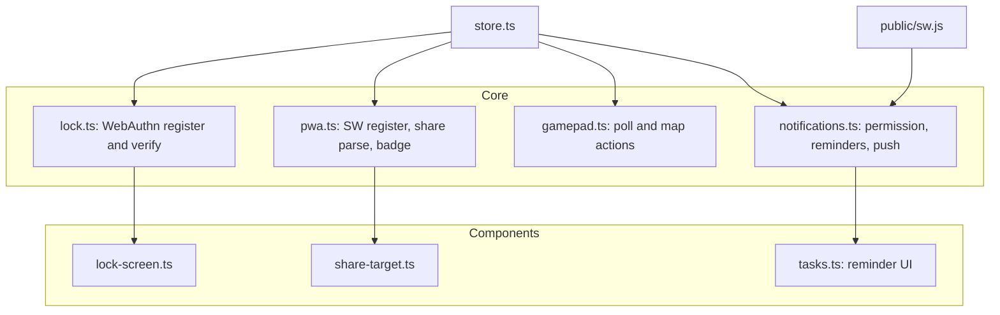

# Hub PWA Enhancements — Implementation Plan

**Status:** Complete — **extended by** [`production-readiness.md`](production-readiness.md) Phase 8, which is now **complete** (build-time precache of the built shell, user-controlled update flow, install UX, storage persistence, complete manifest/iOS metadata/launch images, window-controls-overlay implemented, encrypted GitHub token, CSP authored but enabled in Phase 9). Requirements are specified in [`PRD.md`](../PRD.md) §5.9.

## Goal

Extend the existing local-first Hub PWA with: full PWA support (manifest + SW),
app shortcuts, a share target, app badging, local + push notifications with task
reminders, gamepad navigation, and a WebAuthn app lock — all using native
browser APIs (no new dependencies), integrated with the existing store/component
architecture, typechecked, tested, and committed in logical commits.

## Constraints (from AGENTS.md)

- Vanilla TypeScript + Vite + Vanilla CSS only. No new runtime dependencies.
- No external CDNs; all icons/fonts local.
- No `innerHTML` with user content; no `any`; strict TS.
- `npm run typecheck` and `npm run test` must pass before each commit.
- Preserve existing committed work in `settings.ts`, `tokens.css`,
  `components.css`, `DESIGN.md` (already committed — do not overwrite).

## Authorized schema changes

- `TaskItem.remind_at?: number | null` (explicitly authorized).
- `AppConfig` gains local-only fields (never synced): `notifications_enabled`,
  `vapid_public_key?`, `gamepad_enabled`, `app_lock_enabled`,
  `app_lock_credential_id?`. These are required to persist feature settings.

## Architecture

## Workstreams

### 1. Logo + manifest + shortcuts + share target

- Extract the old Hub logo/icon from the `hub_backup` branch via a temp git
  worktree; copy assets into `public/` (icon.svg, icon-192.png, icon-512.png,
  apple-touch-icon, favicon).
- Extend `public/manifest.json`: `id`, `lang`, `dir`, `categories`,
  `display_override`, `shortcuts` (New Bookmark / New Task / New Note),
  `share_target` (GET, params title/text/url), refreshed icons.
- Update `index.html` icon links.

### 2. Service worker + registration

- Extend `public/sw.js`: `push` -> `showNotification`, `notificationclick` ->
  focus/open client, `message` (badge/skipWaiting), bump cache version.
- Harden SW registration in `main.ts` (already present) and add update flow.

### 3. Badging

- `src/core/pwa.ts`: `updateAppBadge(openTaskCount)` using
  `navigator.setAppBadge`/`clearAppBadge` with feature detection.
- Subscribe to the store `tasks` event in `main.ts` to keep the badge in sync.

### 4. Notifications + task reminders

- `src/core/notifications.ts`: permission request, local reminder scheduling
  (pure `computeDueReminders` + timer), push subscribe/unsubscribe with a
  configurable VAPID public key, SW message handling.
- `TaskItem.remind_at` UI in `tasks.ts` (set/clear reminder).
- Settings toggles for notifications + VAPID key.

### 5. Gamepad navigation

- `src/core/gamepad.ts`: `requestAnimationFrame` polling of
  `navigator.getGamepads()`, debounced button/axis mapping to abstract actions
  (focusNext, focusPrev, activate, back, openOmnibar, toggleTasks, toggleNotes).
- Wire actions in `main.ts` to existing focusable elements.

### 6. App lock (WebAuthn)

- `src/core/lock.ts`: register a platform credential
  (`userVerification: 'required'`, `authenticatorAttachment: 'platform'`) and
  verify via `navigator.credentials.get`; pure state machine for testability.
- `src/components/lock-screen.ts`: overlay gating the app until unlocked.
- Settings toggle to enable/disable the lock.

### 7. Share target handling

- `src/components/share-target.ts`: parse `title`/`text`/`url` query params,
  detect a URL, and offer to create a bookmark or a note; integrate with store.

### 8. Tests + docs

- Unit tests: share-target parsing, badge count, reminder computation, gamepad
  mapping, lock state machine, schema `remind_at`.
- Update `README.md` and `SCHEMAS.md` for the new field/config.

## Logical commits

1. `feat(pwa): hub_backup logo assets, manifest shortcuts and share target`
2. `feat(pwa): service worker push/notification handlers and app badging`
3. `feat(notifications): task reminders and local/push notification manager`
4. `feat(input): gamepad navigation support`
5. `feat(security): WebAuthn app lock`
6. `test(docs): coverage and documentation for PWA enhancements`

## Verification

- `npm run typecheck`, `npm run test`, `npm run build`, `npm run lint`.
- Pre-commit hook (typecheck + tests) runs on each commit.
- Push to `origin main` after all commits.
