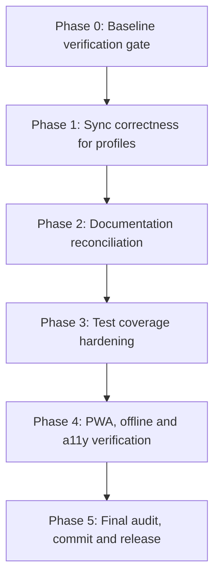

# Hub — Remaining Work: Phased Plan & Progress Review

**Status:** Proposed — awaiting approval
**Parent Specs:** [`PRD.md`](../PRD.md), [`SCHEMAS.md`](../SCHEMAS.md), [`AGENTS.md`](../AGENTS.md)

---

## 1. Progress Review (what is already done)

All originally scoped phases and follow-on initiatives are implemented in the
working tree. Verified by reading the source, plans, and README.

| Initiative                        | Plan                                                             | State    | Evidence                                                                                       |
| --------------------------------- | ---------------------------------------------------------------- | -------- | ---------------------------------------------------------------------------------------------- |
| Phase 1 — Foundation & Data Layer | [`phase-1-foundation.md`](phase-1-foundation.md)                 | Complete | `db.ts` v2 stores + indices, `schemas.ts`, `tokens.css`, strict TS                             |
| Phase 2 — Launchpad & Omnibar     | [`phase-2-launchpad.md`](phase-2-launchpad.md)                   | Complete | `store.ts`, `omnibar.ts`, `bookmarks.ts`, `fallback.ts`, `toast.ts`                            |
| Phase 3 — Productivity Panes      | [`phase-3-productivity-panes.md`](phase-3-productivity-panes.md) | Complete | `drawer.ts`, `tasks.ts`, `notes.ts`, pinning + mobile tabs in `main.ts`                        |
| Phase 4 — Sync & Settings         | [`phase-4-sync-settings.md`](phase-4-sync-settings.md)           | Complete | `sync.ts` (v2 merge + v1 migration), `settings.ts`, export/import                              |
| Phase 5 — PWA & Deploy            | [`phase-5-pwa-deploy.md`](phase-5-pwa-deploy.md)                 | Complete | `manifest.json`, `sw.js`, `deploy.yml`, local icons                                            |
| Multi-Profile & Start Page        | [`main-interface-profiles.md`](main-interface-profiles.md)       | Complete | `header.ts`, `brand.ts`, `profile-popover.ts`, `profile-editor.ts`, `telemetry.ts`, `image.ts` |
| PWA Enhancements                  | [`pwa-enhancements.md`](pwa-enhancements.md)                     | Complete | `pwa.ts`, `notifications.ts`, `gamepad.ts`, `lock.ts`, `share-target.ts`, `lock-screen.ts`     |
| Tasks & Notes Redesign            | [`tasks-notes-redesign.md`](tasks-notes-redesign.md)             | Complete | `tasks.ts`, `notes.ts`, `note-editor.ts`, `utils/text.ts`, pastel tokens                       |

**Test suites present (16):** `db`, `fallback`, `gamepad`, `image`, `lock`,
`notifications`, `pwa`, `store`, `sync`, `telemetry` (core); `drawer`, `notes`,
`omnibar`, `tasks` (components); `schemas` (types); `text` (utils).

### Gaps and risks found during review

1. **Profile mutations do not trigger sync.** In [`main.ts`](../src/main.ts:489)
   the debounced sync loop subscribes only to `bookmarks`, `categories`,
   `tasks`, `notes`. `profiles` is now a syncable collection (v2 payload), so
   editing a profile name/avatar/logo/engine/theme never schedules a push.
2. **Documentation drift.** [`SCHEMAS.md`](../SCHEMAS.md:3) still declares
   `Document Version 1.0.0` and its storage diagram shows the pre-v2 single
   `entities_store`; it does not describe the `profiles` store or
   `profile_id` partitioning. [`DESIGN.md`](../DESIGN.md) predates the system
   header, brand, profile, and telemetry UI.
3. **Plan statuses are stale.** `phase-1` says "Proposed", `phase-2/3/4/5` say
   "In progress", while the README declares all phases complete.
4. **Component test coverage gaps.** No tests for `bookmarks`, `header`,
   `brand`, `profile-popover`, `profile-editor`, `share-target`, `lock-screen`,
   `note-editor`, `toast`, or `settings`.
5. **Profile deletion does not cascade.** `softDeleteProfile` tombstones the
   profile but leaves its entities intact (likely intentional for data
   preservation — needs an explicit decision + doc note).
6. **PWA/offline verification is unproven in-repo.** No recorded Lighthouse
   audit or airplane-mode check; SW cache version bump discipline is manual.

---

## 2. Remaining Work — Phased Breakdown



### Phase 0 — Baseline verification gate

Confirm the current tree is green before changing anything.

- Run `npm run typecheck`, `npm run lint`, `npm run test`, `npm run build`.
- Record the actual test count and bundle size; reconcile with the README.
- Confirm git working-tree state (clean vs. uncommitted) and branch.

**Exit:** all four commands exit 0; baseline numbers recorded.

### Phase 1 — Sync correctness for profiles

- Add `profiles` to the debounced sync subscription in `main.ts`.
- Ensure `setActiveProfile` / `softDeleteProfile` / `upsertProfile` schedule a
  push (they emit `profiles`).
- Add a unit test asserting a profile mutation schedules a sync push.
- Decide and document profile-deletion semantics (cascade vs. preserve).

**Exit:** profile edits propagate to the remote payload; test passes.

### Phase 2 — Documentation reconciliation

- Update `SCHEMAS.md` to v2: `profiles` store, `profile_id` partitioning,
  `version: 2`, corrected storage diagram, `remind_at` and feature config.
- Update `DESIGN.md` for the system header, brand, profile popover/editor,
  telemetry badge, and enlarged search pill.
- Flip `plans/phase-*.md` statuses to "Complete".
- Reconcile README final-audit numbers with Phase 0 results.

**Exit:** docs match the shipped code; no stale version/status claims.

### Phase 3 — Test coverage hardening

- Add component tests for the untested components (prioritise `bookmarks`,
  `settings`, `note-editor`, `share-target`, `profile-editor`).
- Add store tests for profile CRUD, soft-delete, and active-profile switching.
- Keep tests pure/DOM-light using the existing `jsdom` + `fake-indexeddb` setup.

**Exit:** new suites pass; coverage gaps closed for high-risk components.

### Phase 4 — PWA, offline and accessibility verification

- Run a Lighthouse PWA audit; record the result.
- Verify airplane-mode load and core flows (omnibar, drawers, sync-off).
- Confirm SW cache version bump and SPA navigation fallback.
- Spot-check keyboard/a11y: `/` hotkey, focus order, ARIA on new components.

**Exit:** PWA audit passes; offline flows verified; a11y issues logged/fixed.

### Phase 5 — Final audit, commit and release

- Re-run the full quality gate.
- Commit in logical units (sync fix, docs, tests, verification).
- Push to `main`; confirm CI + Pages deploy succeed.

**Exit:** green CI, deployed build, README final audit fully checked.

---

## 3. Verification Commands

```bash
npm run typecheck
npm run lint
npm run test
npm run build
npm run preview
```

## 4. Guardrails (unchanged)

- Vanilla TS + Vite + native CSS; no new runtime dependencies.
- No `any`, no `innerHTML` with user content, no external CDNs.
- `DeviceMetrics` never enters the sync payload.
- Every commit gated by typecheck + tests.
