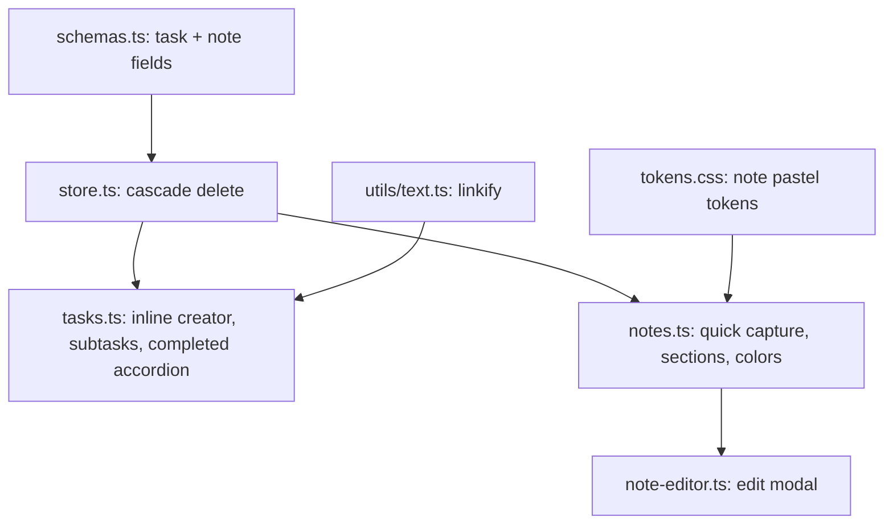

# Tasks & Notes Redesign (Google Tasks / Keep patterns) — Plan

## Goal

Redesign the Tasks (left) and Notes (right) drawers to match the visual
hierarchy and interaction depth of Google Tasks and Google Keep, while keeping
Hub's local-first, zero-framework, warm-neutral design.

## Confirmed behavior rules

1. **`order`** — optional number, defaults to 0. No drag-and-drop. Active tasks
   and notes sort by `order` ascending, then `created_at` descending.
2. **Recurrence** — metadata only. Completing a recurring task just marks it
   completed; no auto-spawn.
3. **Subtasks** — deleting a parent cascades soft-delete to its subtasks.
   Completing a parent does NOT force-complete subtasks; when a parent moves to
   the Completed section its subtasks collapse with it.
4. **Note editing** — clicking a card opens an edit modal (title, body, color).

## Schema changes (authorized)

```ts
export interface TaskItem extends SyncableEntity {
  profile_id: string;
  title: string;
  description?: string;
  completed: boolean;
  completed_at?: number | null;
  remind_at?: number | null; // existing
  parent_id?: string | null; // subtasks
  due_date?: string | null; // 'YYYY-MM-DD'
  due_time?: string | null; // 'HH:mm'
  recurrence?: 'daily' | 'weekly' | 'monthly' | 'yearly' | null;
  order?: number; // default 0
}

export interface NoteItem extends SyncableEntity {
  profile_id: string;
  title: string;
  content: string;
  is_pinned?: boolean;
  color_tag?: 'default' | 'burgundy' | 'amber' | 'sage' | 'terracotta' | 'slate' | string;
  order?: number; // default 0
}
```

Backward compatibility: legacy `color_tag: 'neutral'` is treated as `'default'`;
missing `order`/`is_pinned`/`parent_id` default to `0`/`false`/`null` at read
time (no destructive migration).

## Architecture



## Workstreams

### 1. Schema & store

- Extend `TaskItem`/`NoteItem` as above.
- `store.softDeleteTask` cascades soft-delete to descendants (recursive).
- Pure sort helpers: `sortTasks` (order asc, created_at desc; group children
  under parents; completed last) and `sortNotes` (pinned first, order asc,
  updated_at desc).

### 2. Tasks drawer (Google Tasks)

- Header "My Tasks"; prominent `+ Add a task` inline action.
- Inline creator: title (autofocus), Details textarea, quick chips
  `[Today] [Tomorrow] [Date & Time] [Recurrence]`; Enter saves, Escape collapses.
- Task item: circular radio check with checkmark animation; title + details;
  URLs in title/details rendered as safe anchors; subtasks indented 24px with a
  connector guide; three-dot menu (Add subtask, Set date/time, Delete).
- Completed accordion `Completed (count)` with filled checks, strikethrough, and
  `Completed: Day, Mon DD`; unchecking restores the task.

### 3. Notes drawer (Google Keep)

- Collapsed `Take a note...` quick capture that expands to title, auto-resizing
  body, color palette, pin toggle, and Close/Save.
- Sections `PINNED` / `OTHERS` when pinned notes exist; single list otherwise.
- Pastel cards (default/burgundy/amber/sage/terracotta/slate) with automatic
  light/dark contrast; hover toolbar (palette, pin/unpin, copy, delete).
- Clicking a card opens `note-editor.ts` (title, body, color).

### 4. Utilities & styles

- `src/utils/text.ts`: pure `linkify(text)` returning text/URL segments (tested).
- `tokens.css`: note pastel background/foreground tokens for light and dark.
- `components.css`: task check, subtask indent, chips, accordion, note sections,
  hover toolbar, quick capture.

### 5. Tests & docs

- Unit tests: `sortTasks`, `sortNotes`, `linkify`, store cascade delete, schema
  defaults/back-compat.
- Update `SCHEMAS.md`, `README.md`, `DESIGN.md`.

## Logical commits

1. `feat(schema): task subtasks/dates/recurrence and note pin/color/order fields`
2. `feat(tasks): Google Tasks-style drawer with inline creator and subtasks`
3. `feat(notes): Google Keep-style drawer with quick capture and edit modal`
4. `test(docs): coverage and documentation for the drawer redesign`

## Verification

- `npm run typecheck`, `npm run test`, `npm run build`, `npm run lint`.
- Pre-commit hook (typecheck + tests) on each commit; push to `origin main`.
- Manual: existing tasks/notes render with defaults; subtask cascade delete;
  completed accordion; note sections and edit modal; no console errors offline.
